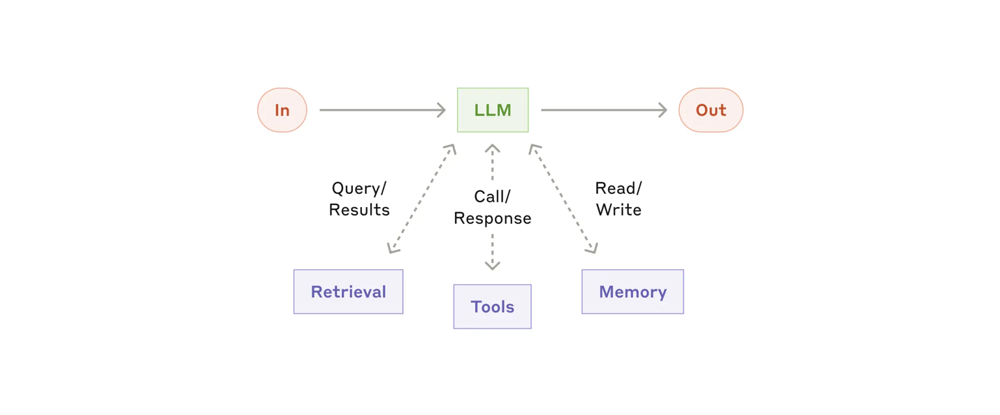
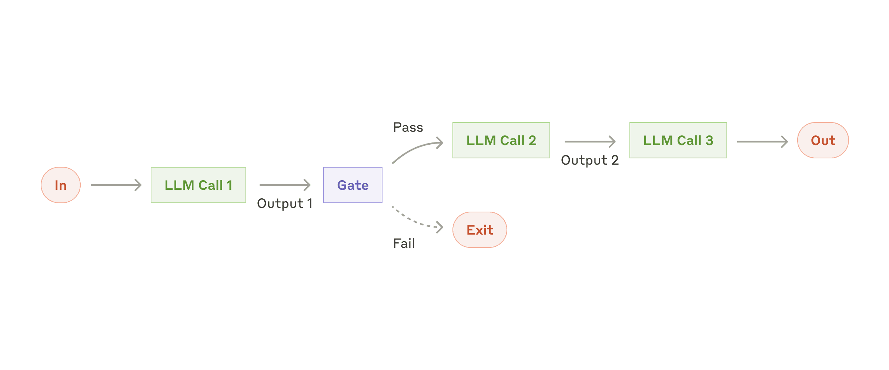
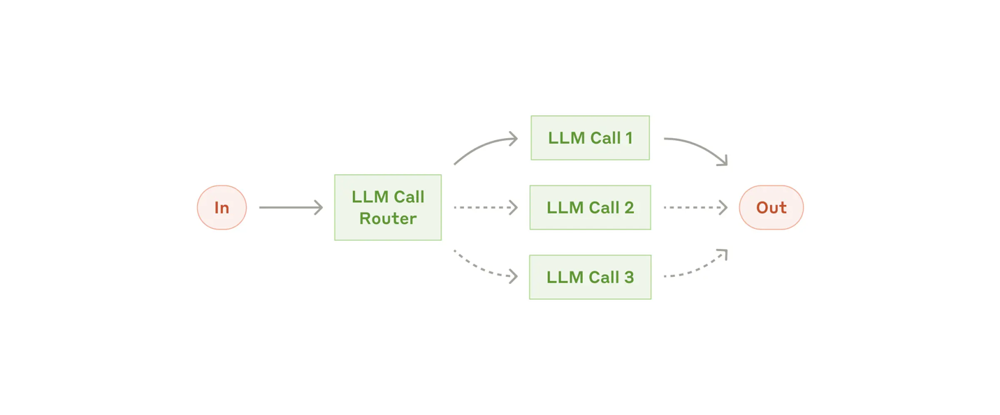
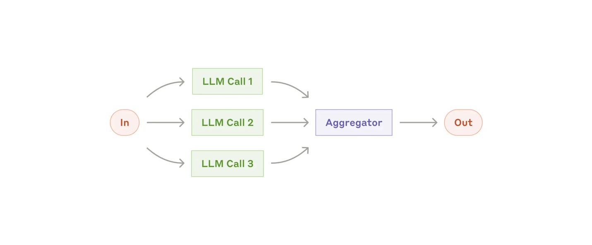
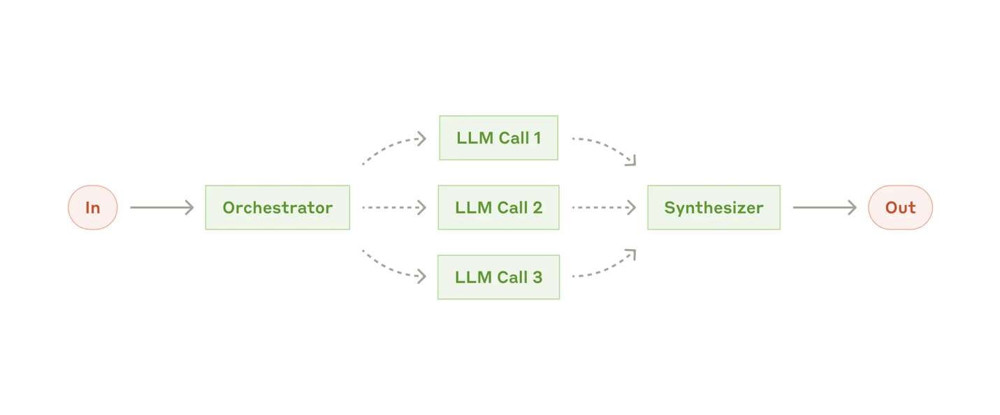
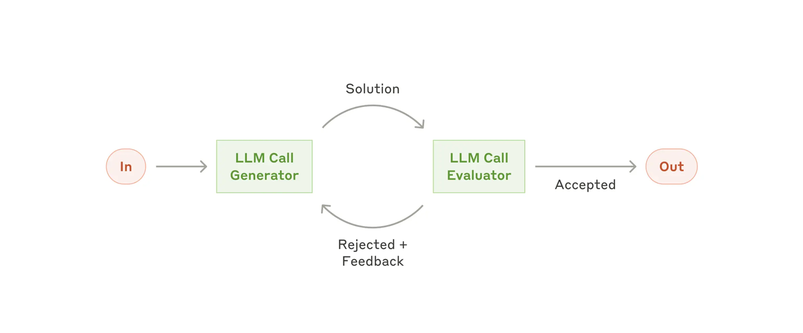
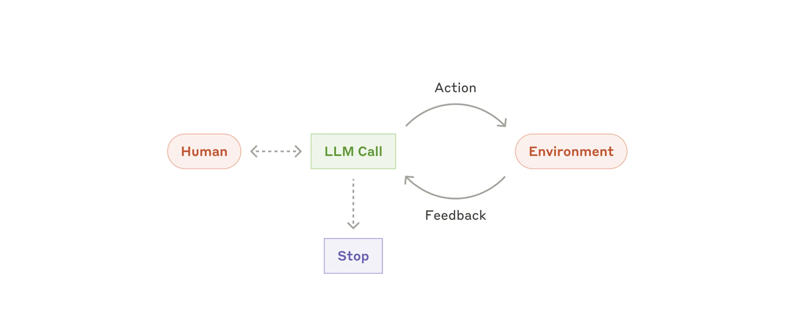
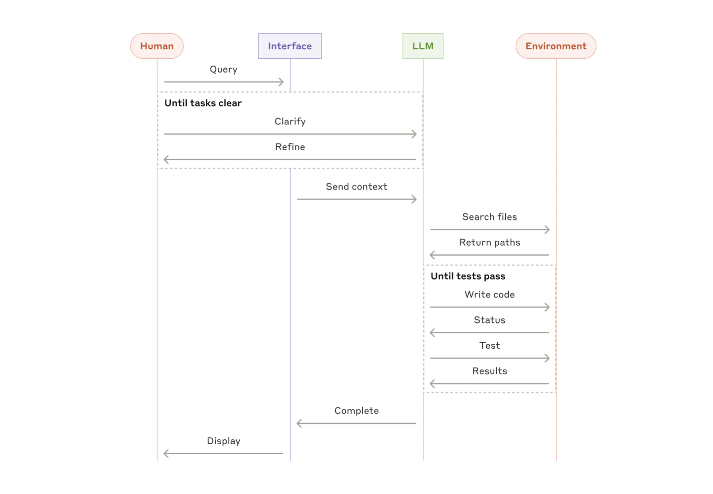

> **Original post**: [Building effective AI agents](https://www.anthropic.com/research/building-effective-agents) (Erik S., Barry Zhang, Anthropic, 2024-12-19)
>
> These are my own notes after reading the original post. The figures are taken from the original post (source: Anthropic).

## 1. What are agents?

Agentic systems fall into two broad categories: workflows and agents.

- **Workflows**: LLMs and tools are orchestrated through predefined code paths.
- **Agents**: LLMs dynamically direct their own process and tool usage.

## 2. When (and when not) to use agents

Agentic systems trade latency and cost for better performance. So the goal should be to find the simplest solution possible, and to add complexity (i.e., use agents) only when it is truly needed.

## 3. Building block: The augmented LLM

The basic building block of agentic systems is an LLM enhanced with augmentations such as retrieval, tools, and memory. Recent models can generate their own search queries, select appropriate tools, and determine what information to retain.

*Figure: The augmented LLM (source: Anthropic)*

## 4. Workflows

### (1) Prompt chaining

The task is decomposed into steps, and the LLM handles them one after another. Gates can be added between steps to check that the process is on track.

- **When to use**: when the task can be cleanly decomposed into fixed subtasks
- **Example**: write an outline of a document, check that the outline meets certain criteria, then write the document based on that outline

### (2) Routing

The input is classified and directed to a specialized follow-up task. This makes it possible to build more specialized prompts.

- **When to use**: when there are distinct categories and classification can be done reliably
- **Example**: send easy, simple tasks to a cost-efficient model like Claude Haiku, and hard, complex tasks to a best-performance model like Claude Opus

### (3) Parallelization

Tasks run in parallel, and their outputs are aggregated.

- **Sectioning**: splitting a task into independent subtasks
- **Voting**: running the same task multiple times to get diverse outputs

**When to use**: when you want to speed things up by splitting the task, or when you want higher confidence through multiple perspectives

**Examples**
- Sectioning: each model evaluates a different aspect of LLM performance
- Voting: several models review a piece of code for vulnerabilities

### (4) Orchestrator-workers

Given a task, a central LLM dynamically breaks it down, delegates the pieces to worker LLMs, and synthesizes their results.

- **Difference from parallelization**: parallelization is used when the subtasks are fixed in advance, whereas orchestrator-workers is used when the subtasks cannot be predicted beforehand.
- **When to use**: when the subtasks cannot be predicted in advance
- **Example**: a coding product that has to make complex changes across multiple files each time

### (5) Evaluator-optimizer

One LLM generates a solution for the input, and another LLM evaluates it and gives feedback. This process repeats in a loop.

- **When to use**: when there are clear evaluation criteria and feedback actually improves the result
- **Example**: translating a sentence with nuances that are hard to capture, where the evaluator LLM can provide useful critiques

## 5. Agents

The implementation is simple: an LLM uses tools in a loop while receiving feedback from the environment (tool results, code execution results).

- At each step, the agent gets ground truth from the environment to judge its progress, and it can also receive human feedback at checkpoints.
- There may be stopping conditions, such as a maximum number of iterations.
- The downsides are higher cost and compounding errors. Agents should be tested extensively in sandboxed environments, with appropriate guardrails.

Below is a figure showing the high-level flow of a coding agent.

## 6. Summary

1. Maintain simplicity in your agent's design.
2. Prioritize transparency by explicitly showing the agent's planning steps.
3. Carefully craft your agent-computer interface (ACI) through thorough tool documentation and testing.

## 7. Appendix 1: Agents in practice

### A. Customer support

- A chatbot-style interface combines naturally with tool integration. The agent can pull in customer data, order history, and knowledge base articles, and even automate real actions such as processing refunds or updating tickets.
- Success can be defined as whether the problem was resolved, which makes it easy to measure. In other words, the success criteria are clear.

### B. Coding agent

- Results can be verified with automated tests, and the agent can loop: see the test failures, then fix the code.
- The problem space is well-defined and structured, and output quality can be evaluated objectively.
- Even if the tests pass, humans still need to review whether the solution fits the overall system requirements.

## 8. Appendix 2: Prompt engineering your tools

Key claim: tool definitions deserve as much care as the main prompt.

### 1) Choosing the output format

The same task can be easy or hard for the model depending on the format.

- Give the model enough room (tokens) to think before it commits to an answer.
- Use formats that appear naturally and frequently in internet text.
- Avoid formatting overhead such as counting lines or escaping strings.

### 2) Designing the ACI (Agent-Computer Interface)

Put as much effort into the agent's interface as you would into a human-facing UI (HCI).

- Imagine using the tool from its description alone. If you would be confused, the model probably will be too.
- Include usage examples, edge cases, input requirements, and clear boundaries from similar tools in the description.
- Write parameter names and descriptions as clearly as a docstring for a junior developer.
- Run many example inputs in something like the Workbench, look at the mistakes the model makes, and iterate.

### 3) Poka-yoke

Change the structure of the parameters so that mistakes are harder to make in the first place.
